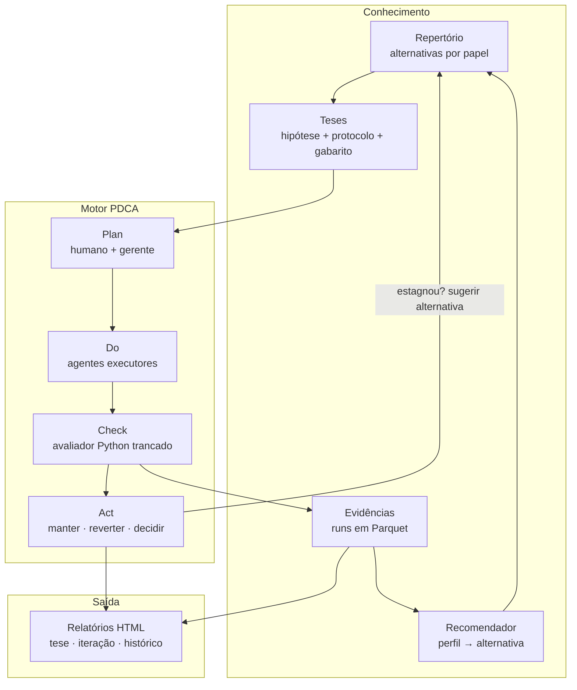
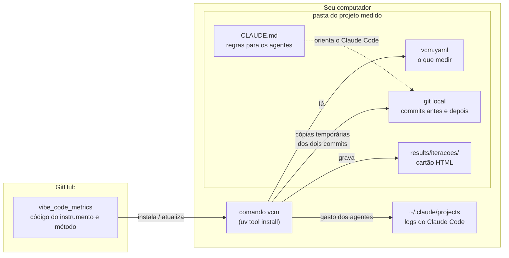
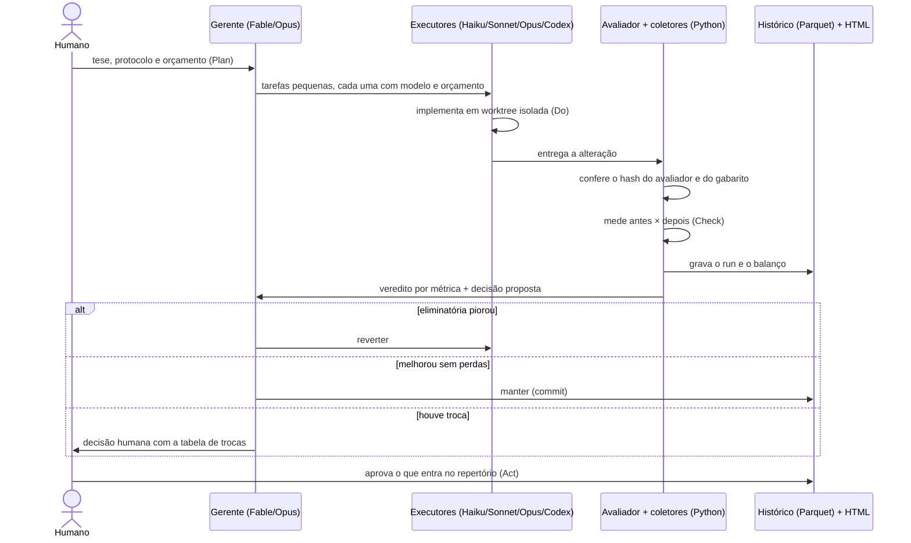
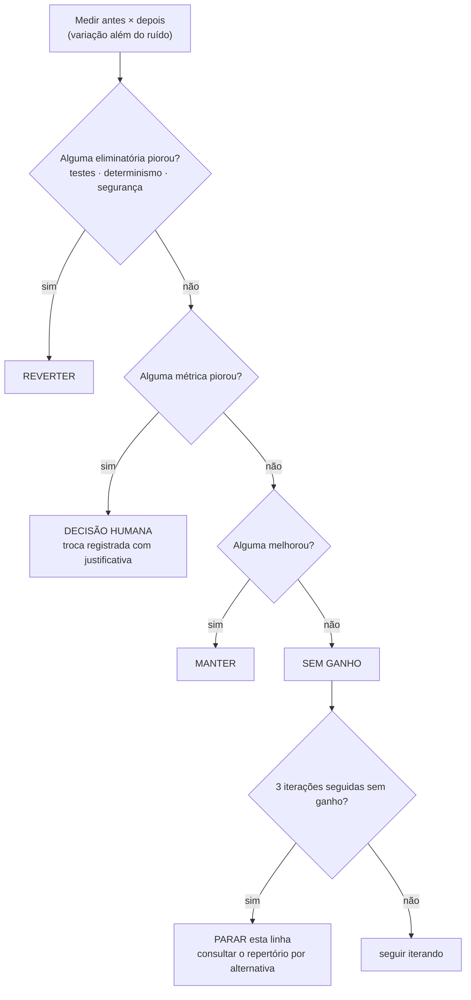
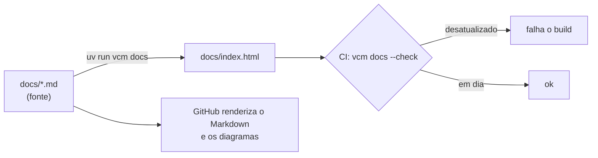

# Arquitetura de funcionamento

> **Vibe Code Metrics** é um laboratório de decisões técnicas para desenvolvimento assistido por IA.
> A IA propõe, o código executa, os testes verificam, as métricas comparam e o humano decide.
> O próprio repositório é desenvolvido com o seu método (tese **T000**).

Versão 0.4 · 02/11/2026 · Status: em uso no `projetos_em_camadas`. Plano de execução: [plano.md](plano.md).
Regras de código: [estilo.md](estilo.md).

## 1. Ideia em uma página

O repositório não escolhe ferramentas por gosto. Ele mantém um **repertório** de alternativas
(NumPy, Polars, Parquet, NetworkX, JSON-LD, Haiku, Sonnet, Opus, Fable, Codex, modelos locais…),
testa essas alternativas em **teses** com gabarito próprio e usa as evidências para **recomendar**
o que usar em cada perfil de problema. Cada iteração de código termina com uma **retrospectiva
medida**: ficou mais eficiente, mais determinístico, mais enxuto, mais robusto? Perdeu algo?
Vale continuar?



### Na prática: o instrumento e o projeto medido

O `vcm` é um **instrumento instalado no computador**, como uma trena: não fica dentro do projeto
e não precisa do `vibe_code_metrics` clonado. Ele lê o git local da pasta onde é chamado e grava o
resultado nessa mesma pasta.



| De onde vem | O que o vcm tira dali |
|---|---|
| `vcm.yaml` do projeto | pastas do código, pasta de testes, comando de referência, dependências extras dos testes, limites do semáforo |
| git local (dois commits) | código-fonte medido em cópias temporárias: complexidade, densidade, dependências, segurança, testes, cobertura, reprodutibilidade, tempo e memória |
| `~/.claude/projects` (logs do Claude Code) | chamadas, tokens e custo equivalente de API por modelo, entre os dois commits, no repositório ou nas worktrees dos agentes |
| catálogo de preços | `repertorio/modelos.yaml`; noutro projeto, a cópia empacotada no próprio `vcm` |

Consequências:
- **O gasto é por máquina.** Os logs ficam no computador onde o Claude Code rodou; trabalho feito
  noutra máquina ou na nuvem não aparece no cartão.
- **O cache é por pasta.** As medições ficam em `results/snapshots.parquet` de cada cópia do projeto.
- **Nada é enviado.** O `vcm` só lê arquivos locais e grava o cartão; não chama nenhuma API.

## 2. Componentes

| Componente | O que é | Formato | Pasta |
|---|---|---|---|
| **Repertório** | Alternativas classificadas por **papel** (extração, cálculo, armazenamento, intercâmbio, apresentação, orquestração de IA). Só se compara o que cumpre o mesmo papel. | YAML | `repertorio/` |
| **Catálogo de skills** | Habilidades de agente (pasta com `SKILL.md`): do projeto, da plataforma, de plugins e externas. Dizem **como** conduzir uma tarefa e quais ferramentas do repertório usam. Página: [skills.md](skills.md). | YAML | `repertorio/skills/` |
| **Catálogo de modelos** | Modelos de IA disponíveis, preço, data de verificação e papéis sugeridos. Atualizado quando um fornecedor lança modelo novo, o que dispara regressão. | YAML | `repertorio/modelos.yaml` |
| **Tese** | Hipótese falsificável + protocolo (métricas, tolerâncias, orçamento, repetições) + gabarito congelado + decisão. | Markdown + YAML | `theses/Txxx-*/` |
| **Runner** | Executa alternativas sobre os mesmos casos, com repetições, isolamento em subprocesso, pico de RAM, hash de saída. | Python | `src/vcm/runners/` |
| **Coletores** | Medição passiva: telemetria do agente, git, análise estática, testes. | Python → Parquet | `src/vcm/coletores/` |
| **Avaliador** | Compara a saída com o gabarito por tolerância declarada. É código determinístico e os agentes não podem alterá-lo. | Python | `theses/*/avaliador.py` |
| **Balanço** | Retrospectiva de iteração: antes × depois, veredito por métrica e decisão proposta. | Python | `src/vcm/balanco.py` |
| **Recomendador** | Consulta as evidências por perfil de problema. | Python | `src/vcm/recomendador.py` |
| **Relatórios** | HTML autocontido com Plotly, um por tese, um por iteração e um painel histórico. | HTML | `results/reports/` |
| **Documentação** | Este Markdown é a fonte. `vcm docs` gera `docs/index.html`, e o CI garante que o HTML está em dia. | MD → HTML | `docs/` |

## 3. O ciclo PDCA de uma iteração

Uma **iteração** é um commit ou um PR. Ela pode ser feita por um humano, por um agente ou por
vários agentes coordenados por um gerente.



### Quem faz o quê

| Etapa | Responsável | Regra que não se negocia |
|---|---|---|
| **Plan** | Humano + gerente | Protocolo, métricas, tolerâncias e gabarito commitados **antes** de rodar |
| **Do** | Executores | Cada um trabalha numa worktree isolada, com orçamento de tokens e de tempo |
| **Check** | **Código Python**, nunca uma IA | Avaliador e gabarito com hash conferido. Alteração detectada invalida o run. |
| **Act** | Regra automática + humano | Reverter e manter podem ser automáticos. Trocas e entradas no repertório exigem aprovação humana. |

## 4. Retrospectiva de iteração

Ao fim de cada iteração, o repositório faz as provocações abaixo. Primeiro responde com números,
depois a IA interpreta e, por fim, o humano decide.

| Pergunta | Métricas (antes × depois) | Coleta |
|---|---|---|
| Ficou **mais eficiente**? | tempo p50/p95, pico de RAM, custo da iteração | pytest-benchmark ou asv, psutil, telemetria |
| Ficou **mais determinístico**? | fração de execuções idênticas em N repetições, cobertura determinística ponderada | runner + numpy |
| Ficou **mais enxuto**? | SLOC, complexidade média, duplicação, nº de dependências | radon, ruff, `pyproject.toml` |
| Ficou **mais robusto**? | testes falhando, cobertura, mutation score, alertas de segurança | pytest, coverage, mutmut, bandit |
| **Perdeu** algo? | toda métrica que piorou além do ruído | `vcm.balanco` |
| Vale **continuar** nessa linha? | tendência das últimas k iterações e ganho ÷ custo | histórico em Parquet |



### Radar de semáforo

O cartão de cada iteração traz duas leituras, ambas calculadas em Python:

- **Radar (relativo):** por dimensão, um índice com antes = 1,0, calculado como a média
  geométrica das razões depois/antes orientadas para que acima de 1,0 seja melhor.
- **Semáforo (absoluto):** cada métrica recebe 🟢🟡🔴 por limites (`limites_padrao.yaml`, que
  podem ser sobrepostos no `vcm.yaml` do projeto); a cor da dimensão é a pior entre as suas
  métricas, e ⚪ indica sem medição.

Exemplos reais: [cartão MANTER](exemplos/cartao-manter.html) e
[cartão REVERTER](exemplos/cartao-reverter.html), gerados no teste ponta a ponta.

O **ruído** de cada métrica vem de repetições. O tempo de execução oscila alguns por cento,
enquanto SLOC não oscila nada. Uma variação dentro do ruído é declarada "igual", nunca
"melhorou". O critério de parada funciona como num método iterativo: quando o resíduo para de
cair, insistir só gasta tokens.

### Desempenho do método: o vcm melhora os projetos?

A pergunta final do método é sobre ele mesmo. A resposta vem do histórico do git de cada projeto,
comparando antes × depois da **adoção** (o commit que criou o `vcm.yaml`):

```bash
vcm historico --passo 5
vcm efeito
```

- `vcm historico` mede commits passados (amostra a cada `passo`, sempre o primeiro e o último),
  reaproveitando o cache de snapshots.
- `vcm efeito` compara, por métrica julgada, médias e tendências antes × depois, conta os cartões
  por decisão (REVERTER = problema pego antes de entrar) e gera `results/efeito.html` com a linha
  da adoção nos gráficos.

Regras para não enganar a si mesmo:

| Regra | Por quê |
|---|---|
| Veredito só com **5 ou mais commits de cada lado** | média e tendência de 3 pontos não sustentam conclusão |
| Commits **sem código** ficam fora | o commit inicial vazio inverteu a direção da complexidade no primeiro teste real |
| **Ressalvas antes da tabela** | estudo observacional de um projeto: crescimento de escopo também mexe nas métricas; correlação não é causa |
| Métricas que só existem depois da adoção (tempo, RAM, reprodutibilidade) | ficam "insuficiente"; servem para a comparação entre iterações, não antes × depois |

Com vários projetos adotando o método, o mesmo relatório por projeto permite comparar efeitos;
com um só, ele é descritivo.

## 5. O que é medido passivamente e o que exige protocolo

| Passivo (basta instrumentar) | Exige protocolo de tese |
|---|---|
| Tokens e custo equivalente de API por chamada, por agente e por modelo (**logs de sessão: implementado**; OpenTelemetry adiado) | Delimitação da tarefa e critério de "aprovada" |
| Edições aceitas e rejeitadas, tempo ativo, linhas, commits, PRs | Gabarito e tolerâncias por grandeza (cotas: tolerância **absoluta**) |
| Trailers `Co-Authored-By` (o que a IA escreveu) | Classificação das intervenções humanas |
| Testes, cobertura, complexidade e segurança no CI | Repetições, variância e intervalos de confiança |
| Histórico git: churn e retrabalho em 14 dias | Linha de base de sistema existente (testes de caracterização) |
|  | Pesos de criticidade do índice de determinismo |

Cada sessão de agente é marcada com `OTEL_RESOURCE_ATTRIBUTES="tese=T000,tarefa=..."`. É essa
marcação que liga a telemetria à tarefa e permite calcular **custo por tarefa aprovada**.
Em planos de assinatura, o custo medido é **equivalente de API**, não o gasto real. O relatório
precisa dizer isso.

## 6. Multiagente e catálogo de modelos

**Configuração atual (decisão do mantenedor):** o **Opus** é o modelo máximo e atua como
**gerente** na sessão principal. Ele delega ao **Sonnet** e ao **Haiku**. O Fable não é usado
neste momento.

| Papel | Modelo | Faz | Não faz |
|---|---|---|---|
| **Gerente** | Opus (sessão principal) | Decompõe a fase em tarefas com especificação e teste de aceite; escolhe o executor; integra; roda o balanço; leva trocas ao humano | Tarefas mecânicas que um executor faz mais barato |
| **Executor padrão** | Sonnet | Implementação com testes a partir de especificação clara (coletores, protótipos de tese) | Decidir arquitetura |
| **Executor mecânico** | Haiku | Entradas de repertório, ajustes de lint, testes a partir de exemplos, resumos | Qualquer coisa ambígua |
| **Revisor** | Opus, ou outro fornecedor na Fase 7 | Revisão do que um executor entregou | Revisar o próprio código |
| **Avaliador (Check)** | **Python, não é IA** | `vcm balanco`, testes, tolerâncias | — |
| **Dados confidenciais** | Modelo local de pesos abertos (Fase 7) | Desenho de cliente não sai da máquina | — |

Cada execução delegada é registrada em `results/agentes/execucoes.csv` com modelo, tokens,
chamadas de ferramenta, duração e se a entrega foi aprovada na integração. Essa é a base de
dados da tese **T003 (roteamento)**: a tabela acima é hipótese e passa a ser corrigida pelo custo
por tarefa aprovada de cada modelo.

Nenhum nome de modelo fica fixo no código: tudo vem de `repertorio/modelos.yaml`.

### Modelo × skill × ferramenta

Três escolhas independentes compõem cada tarefa:

| Escolha | Pergunta | Onde está |
|---|---|---|
| **Modelo** | quem executa (custo × capacidade) | `repertorio/modelos.yaml`, tabela acima |
| **Skill** | como conduzir (passo a passo, cuidados, quando parar) | [skills.md](skills.md) |
| **Ferramenta** | com o que calcular (biblioteca Python) | [repertorio.md](repertorio.md) |

Uma tarefa repetível de domínio (ler uma prancha, quantificar uma vala) vira **skill do projeto**,
com o cálculo em código determinístico; a skill orienta o agente e aponta o código. Skills
externas entram como **candidatas**: lidas antes de instalar, porque podem trazer scripts que
rodam na máquina.

## 7. Repertório: uma entrada

```yaml
# repertorio/calculo/numpy.yaml
id: numpy
papel: calculo
quando_considerar: [matriz densa, algebra linear, vetorizacao]
cuidados: [ordem de soma muda com threads do BLAS -> medir determinismo]
evidencias:
  - tese: T005-perda-de-carga
    perfil: {n_trechos: 5000, dtype: float64, operacao: cumsum}
    resultado: venceu
    metricas: {tempo_p50_ms: null, pico_ram_mb: null, deterministico: null}
    run: results/runs/T005/....parquet
status: em_teste   # em_teste | aprovado | rejeitado
```

Alternativas que não competem entre si não são comparadas. NumPy (cálculo matricial) e Polars
(tabelas) costumam **cooperar**: Polars filtra e junta, `.to_numpy()` calcula. NetworkX
(algoritmos em memória) e JSON-LD (intercâmbio semântico) estão em papéis diferentes.

## 8. Dados e formatos

| Dado | Formato | Por quê |
|---|---|---|
| Protocolos, repertório, catálogo de modelos | YAML | Legível, versionado em git, validado com schema |
| Runs, telemetria normalizada, histórico de iterações | Parquet | Colunar, tipado, lido direto por pandas e Polars |
| Telemetria bruta | JSON Lines | Como sai dos coletores, sem perda |
| Hash de entradas e saídas | SHA-256 sobre os **dados** (não sobre os bytes do arquivo) | Metadados do Parquet mudam sem os dados mudarem |
| Documentação e relatórios | Markdown → HTML | Markdown para editar e versionar, HTML para ler |

## 9. Estrutura do repositório

```text
vibe_code_metrics/
  README.md                 método (visão geral)
  CLAUDE.md                 regras para agentes que trabalham aqui
  docs/
    arquitetura.md          este documento (fonte)
    plano.md                plano de implementação (fonte)
    estilo.md               regras de código do mantenedor
    index.html              gerado por `vcm docs`
  repertorio/               alternativas por papel + modelos.yaml
  theses/
    T000-autodesenvolvimento/
    T001-extracao-pranchas/ ...
  src/vcm/
    balanco.py              retrospectiva de iteração
    docs.py                 Markdown -> HTML
    coletores/              git, código, testes, telemetria
    runners/                execução de teses
    relatorios/             HTML com Plotly
  results/
    iteracoes/              balanço de cada iteração (Parquet + HTML)
    runs/                   runs de teses
  tests/
  reports/, research_notes/ pesquisa de referência
```

## 10. Princípios invioláveis

1. **Cálculo final de engenharia é código determinístico**, com teste.
2. **Avaliador e gabarito são trancados**: hash conferido a cada run, e os agentes não têm permissão de escrita neles.
3. **Critérios são fixados antes dos resultados**, com commit do protocolo antes do run.
4. **Nada vira nota única**: as métricas aparecem lado a lado e as eliminatórias vêm primeiro.
5. **Toda variação é comparada com o ruído** medido em repetições.
6. **Orçamento por ciclo** (tokens, tempo e custo) com critério de parada.
7. **Entrada no repertório exige aprovação humana**, registrada em `decision.md`.
8. **Dados confidenciais** só vão para modelos autorizados pela política da tese.

## 11. O repositório como protótipo dele mesmo (T000)

O desenvolvimento do `vcm` é a primeira tese. Cada PR deste repositório passa pela retrospectiva
(seção 4), e o histórico mostra, ao longo do tempo:

- quanto custou cada funcionalidade e qual modelo a fez;
- se o código ficou mais enxuto, robusto e determinístico, ou se degradou;
- quando uma linha de trabalho convergiu e foi trocada.

Detalhes em [theses/T000-autodesenvolvimento](../theses/T000-autodesenvolvimento/hypothesis.md).

## 12. Como esta documentação se mantém atualizada



A geração é **determinística**: sem data no arquivo, o mesmo Markdown sempre produz os mesmos
bytes. Assim o CI consegue detectar HTML desatualizado. A regra está em `CLAUDE.md`, para que
qualquer agente regenere o HTML ao editar a documentação.
