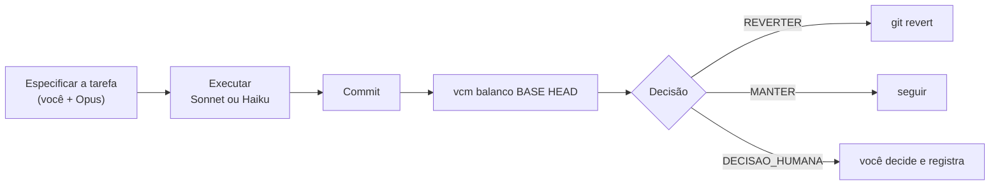

# Guia rápido: usar o vcm num protótipo

> Passo a passo para aplicar o método a um projeto de engenharia em Python, do zero ao primeiro
> cartão de retrospectiva com radar de semáforo. Como funciona por dentro: [arquitetura.md](arquitetura.md).
> Regras de código: [estilo.md](estilo.md).

## 1. Instalar

O `vcm` é instalado como ferramenta do `uv`, direto do GitHub:

```bash
uv tool install git+https://github.com/CAIOZANETTI/vibe_code_metrics
vcm --help
```

Para atualizar: `uv tool upgrade vibe-code-metrics`.

## 2. Preparar o protótipo

O `uv init` cria o `pyproject.toml` e a pasta `src/calculo/`:

```bash
mkdir meu-prototipo && cd meu-prototipo
git init
uv init --package --name calculo
uv add numpy pandas
uv add --dev pytest
vcm iniciar . --pacote calculo
git add -A && git commit -m "Início do protótipo com vcm"
```

O `vcm iniciar` cria, sem sobrescrever o que já existe:

| Arquivo | Para quê |
|---|---|
| `vcm.yaml` | onde está o código, os testes e o conjunto de referência |
| `CLAUDE.md` | suas regras e o ciclo de trabalho, lidos por todo agente |
| `docs/estilo.md` | Python em português, Python calcula, HTML apresenta, SI |
| `.claude/agents/executor-sonnet.md`, `executor-haiku.md` | executores com modelo fixado |
| `src/calculo/referencia.py` | casos de cálculo usados para medir determinismo, tempo e memória |
| `tests/test_referencia.py` | o hash de referência é estável |
| `.github/workflows/vcm.yml` | retrospectiva automática em cada PR |

## 3. O conjunto de referência

Coloque em `src/calculo/referencia.py` os cálculos que **não podem mudar de resultado sem
querer**, por exemplo a linha piezométrica, o dimensionamento de uma seção ou um volume de corte
e aterro. A cada iteração, o `vcm`:

- roda o conjunto N vezes e confere se o hash é sempre o mesmo (**determinismo**);
- mede o tempo e o pico de memória (**eficiência**).

A última linha impressa precisa ser um JSON: `{"hash": ..., "tempo_ms": ..., "pico_ram_mb": ...}`.
O modelo gerado já faz isso.

## 4. O ciclo de cada iteração



Depois de cada commit (ou par de commits) de uma tarefa, meça e abra o cartão com radar e
semáforo (`results/iteracoes/<base>_<alvo>.html`):

```bash
vcm balanco HEAD~1 HEAD
open results/iteracoes/*.html
```

No Linux, troque `open` por `xdg-open`; no Windows, por `start`.

O cartão responde, com números:

- ficou mais **eficiente**?
- ficou mais **determinístico**?
- ficou mais **enxuto**?
- ficou mais **robusto**?
- **perdeu** algo?

O **radar** compara antes e depois por dimensão (1,0 = igual; maior é melhor). O **semáforo**
mostra o estado atual de cada dimensão:

- 🟢 dentro do limite;
- 🟡 atenção;
- 🔴 fora do limite;
- ⚪ sem medição.

Os limites padrão podem ser ajustados em `vcm.yaml`, na chave `limites`.

## 5. Usar os agentes

Na sessão do Claude Code, o Opus é o gerente. Peça explicitamente:

> "Use o executor-sonnet para implementar X com testes, numa worktree. Depois rode o balanço."

| Tarefa | Agente |
|---|---|
| Cálculo novo, módulo com lógica, protótipo de alternativa | `executor-sonnet` |
| Tabelas de dados, ajustes de lint, testes a partir de exemplos | `executor-haiku` |
| Decompor, revisar, integrar, decidir trocas | sessão principal (Opus) |

Cada execução pode ser registrada para comparar custo e qualidade entre modelos:

Registrar uma execução e ver os tokens por tarefa aprovada, por modelo:

```bash
uv run python -c "from vcm import agentes; agentes.registrar(modelo='claude-sonnet-5-5', tarefa='...', tokens=..., duracao_s=..., aprovado=True)"
vcm agentes
```

### Gasto dos agentes (automático)

O `vcm balanco` lê os logs locais do Claude Code (`~/.claude/projects`) e mostra no cartão quanto
os agentes gastaram entre os dois commits, por modelo, em tokens e em custo equivalente de API.
Para ver tudo de uma sessão, por agente (tipo, tarefa, modelo, tokens, duração, custo), e o
registro próprio do projeto, quando existir:

```bash
vcm sessoes --saida results/sessoes
vcm agentes --pdca pdca/agentes.jsonl
```

Em plano de assinatura o custo é "equivalente de API", não o gasto real.

## 6. Comparar alternativas (teses)

Quando houver dúvida entre duas formas de fazer, por exemplo NumPy × Polars, não escolha por
gosto: implemente as duas atrás da mesma interface, meça e registre. O exemplo completo está na
tese **T005** deste repositório (`theses/T005-perda-de-carga/` e `src/vcm/prototipos/perda_de_carga/`):
dados sintéticos, gabarito independente, runner com repetições e relatório HTML.

## 7. Calibrar o ruído

Antes de confiar em "ficou mais eficiente", meça quanto as métricas oscilam sem mudança de código:

```bash
uv run python -c "from pathlib import Path; from vcm import ruido; ruido.gravar(ruido.estimar(ruido.medir_repetido(Path('.'), repeticoes=3)))"
```

O balanço passa a usar `results/ruido.parquet` automaticamente.

## 8. Problemas comuns

| Sintoma | Causa provável |
|---|---|
| "Ficou mais determinístico?" = sem medição | `referencia.comando` ausente no `vcm.yaml` ou o módulo não imprime o JSON |
| Determinismo < 1,0 com NumPy | Número de threads do BLAS variando; fixe `OPENBLAS_NUM_THREADS` (ver repertório do NumPy) |
| Balanço lento | A suíte de testes roda dentro da medição; use `--sem-testes` para uma leitura rápida |
| "Pico de RAM" sem medição no Windows | O conjunto de referência mede memória com `psutil`; instale com `uv add --dev psutil` |
| `unrecognized arguments: # ...` no Mac | O zsh não aceita comentário na mesma linha do comando; rode `setopt interactivecomments` (ou ponha no `~/.zshrc`) |
| Balanço com `--sem-testes` e depois sem a opção | Desde a versão atual o `vcm` remede o commit quando faltam os testes; em versões antigas, use `--refazer` |
| `REVERTER` inesperado | Veja a linha vermelha do cartão: teste falhando, alerta de segurança ou hash instável |
