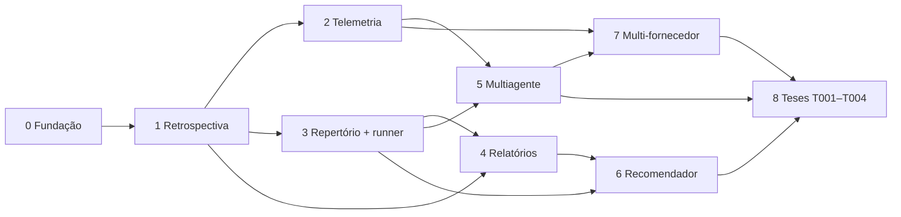

# Plano de implementação

> Roteiro para implementar o Vibe Code Metrics **usando o próprio método** (tese T000).
> Cada fase é entregue em PRs pequenos. A partir da Fase 1, cada PR termina com a retrospectiva
> de iteração. Arquitetura de referência: [arquitetura.md](arquitetura.md).

Legenda: `[x]` feito · `[ ]` a fazer · **Aceite** = critério objetivo para fechar a fase.

## Visão geral das fases

| Fase | Entrega | Depende de | Status |
|---|---|---|---|
| 0 | Fundação: pacote, documentação viva, balanço, CI, T000 | — | concluída |
| 1 | Retrospectiva automática por iteração (`vcm snapshot` / `vcm balanco`) | 0 | em andamento |
| 2 | Telemetria de agentes e custo por iteração | 1 | a fazer |
| 3 | Repertório, schema de tese e runner; primeira tese técnica (T005) | 1 | a fazer |
| 4 | Relatórios HTML com Plotly e painel histórico | 1, 3 | a fazer |
| 5 | Orquestração multiagente com avaliador trancado | 2, 3 | a fazer |
| 6 | Recomendador (`vcm sugerir`) | 3, 4 | a fazer |
| 7 | Multi-fornecedor (Codex, modelos locais) e política de dados | 2, 5 | a fazer |
| 8 | Teses do primeiro programa (T001–T004) no projeto-em-camadas | 3–7 | a fazer |

## Fase 0 — Fundação

- [x] `pyproject.toml` com `uv`, pacote `vcm` em `src/`, CLI `vcm`
- [x] `vcm.balanco`: tabela antes × depois, veredito com ruído, regra de decisão, convergência, com testes
- [x] `vcm docs`: Markdown → HTML único e determinístico, com diagramas Mermaid e `--check`
- [x] `docs/arquitetura.md` e `docs/plano.md` (este arquivo)
- [x] CI no GitHub Actions: `ruff`, `pytest` e `vcm docs --check`
- [x] `CLAUDE.md` com as regras para agentes
- [x] Esqueleto da tese T000 (`hypothesis.md`, `protocol.yaml`)
- [x] `docs/estilo.md`: regras de código do mantenedor (português, Python calcula, HTML apresenta, SI)

**Aceite:** `uv run pytest` verde; `uv run vcm docs --check` verde; HTML abre com navegação e diagramas.

## Fase 1 — Retrospectiva automática

Objetivo: toda iteração (commit ou PR) gera o balanço antes × depois sem trabalho manual.
Executada com agentes: **Opus** gerencia e integra; **Sonnet** e **Haiku** executam (modelo indicado em cada item).

- [ ] `vcm.coletores.codigo` (Sonnet): SLOC e complexidade média (radon), nº de dependências (`pyproject.toml`), alertas de segurança (bandit)
- [ ] `vcm.coletores.testes` (Sonnet): testes totais e falhando, cobertura (coverage.py), tempo da suíte
- [ ] `vcm.coletores.determinismo` + `vcm.referencia` (Sonnet): N execuções do conjunto de referência em subprocesso, com fração de saídas idênticas por hash
- [ ] `vcm snapshot [--ref REF]` (Opus): mede um ref via `git worktree` e grava uma linha em `results/snapshots.parquet`
- [ ] `vcm balanco BASE HEAD` (Opus): compara dois snapshots, grava `results/iteracoes/` e gera o cartão em Markdown e HTML
- [ ] Registro de execuções de agentes em `results/agentes/execucoes.csv` (Opus)
- [ ] Estimar o **ruído** de cada métrica com repetições e gravar em `results/ruido.parquet`
- [ ] GitHub Action em PR: roda o balanço contra a base e anexa o cartão HTML como artefato
- [ ] Registrar a Fase 0 como linha de base da T000

Trabalho antecipado das Fases 3 e 4, a pedido do mantenedor:

- [ ] Repertório inicial em `repertorio/` (Haiku): uma entrada YAML por alternativa, por papel
- [ ] Protótipo da **T005 — perda de carga na adutora** (Sonnet): NumPy × Polars × Polars + NumPy, com dados sintéticos, gabarito analítico, runner e relatório HTML com Plotly

**Aceite:** o PR mostra o cartão com as 6 perguntas respondidas por números; uma regressão
proposital em teste resulta em `REVERTER`.

## Fase 2 — Telemetria de agentes

Objetivo: custo, tokens e tempo de cada iteração, ligados à tese e à tarefa.

- [ ] Documentar a ativação: `CLAUDE_CODE_ENABLE_TELEMETRY=1`, exportador OTLP e `OTEL_RESOURCE_ATTRIBUTES=tese=...,tarefa=...`
- [ ] Receptor local mínimo (coletor OpenTelemetry com exportador de arquivo, ou receptor OTLP em Python) → JSONL → Parquet
- [ ] Alternativa sem coletor: parser dos logs de sessão locais do Claude Code → Parquet (validar o caminho e o formato atuais antes)
- [ ] `repertorio/modelos.yaml`: modelo, fornecedor, preço por milhão de tokens (entrada, saída, cache), **data e fonte da verificação**
- [ ] Custo da iteração no balanço: tokens, custo equivalente de API, nº de chamadas, edições rejeitadas
- [ ] Indicadores: `tokens_por_aprovacao`, `custo_por_aprovacao` (incluindo tempo humano), `taxa_de_retrabalho`

**Aceite:** uma sessão real de Claude Code numa tarefa da T000 aparece no balanço com custo e
tokens; a soma confere com o painel do fornecedor dentro de 5%.

## Fase 3 — Repertório, tese e runner

- [ ] Schemas pydantic: entrada de repertório, `protocol.yaml`, registro de run (campos da seção 10 do README, mais git commit, lockfile, seed, versões do gabarito e do protocolo)
- [ ] `vcm tese nova Txxx` cria a estrutura da tese a partir de um modelo
- [ ] Runner: mesma entrada para cada alternativa, N repetições, subprocesso isolado, pico de RSS, hash dos dados de saída, tempo p50/p95
- [ ] Avaliador trancado: hash do avaliador e do gabarito gravado no protocolo e conferido no run
- [ ] Separação desenvolvimento/teste no gabarito (holdout congelado)
- [ ] **T005 — Perda de carga na adutora**: NumPy × Polars × Polars + NumPy
  - caso: perfil de 5 km com N trechos; Hazen-Williams e Darcy-Weisbach
  - gabarito: solução analítica ou de referência com tolerância **absoluta** (m.c.a.)
  - métricas: tempo, RAM, determinismo (threads 1 × N), SLOC, legibilidade (revisão)

**Aceite:** `vcm tese rodar T005` produz runs em Parquet e um `decision.md` preenchido com as evidências.

## Fase 4 — Relatórios HTML

- [ ] Template base compartilhado com `vcm docs` (mesma identidade visual)
- [ ] Relatório de tese: protocolo, tabela por alternativa, gráficos Plotly (distribuição de tempo, Pareto custo × qualidade), decisão
- [ ] Relatório de iteração: o cartão da Fase 1, com links
- [ ] Painel histórico: trajetória de cada métrica por iteração, marcando convergência e degradação
- [ ] Índice `results/reports/index.html` ligando tudo

**Aceite:** os três relatórios abrem offline (Plotly embutido ou em CDN com fallback) e são gerados de forma determinística.

## Fase 5 — Orquestração multiagente

- [ ] Definição de agentes por papel (gerente, executor, revisor) com modelo vindo de `modelos.yaml`
- [ ] Loop PDCA: o gerente decompõe; o executor trabalha numa worktree; o avaliador confere; o balanço decide
- [ ] Orçamento por ciclo (tokens, tempo, custo) e critério de parada (convergência ou orçamento)
- [ ] Bloqueio de escrita em avaliador e gabarito (permissões do agente + hash conferido)
- [ ] Portão humano para trocas e para entradas no repertório
- [ ] **T003 — Roteamento**: mesmo conjunto de tarefas com Haiku, Sonnet e Opus como executores; custo por tarefa aprovada

**Aceite:** um ciclo autônomo de pelo menos 3 iterações numa tarefa da T000, com balanço
registrado e pelo menos uma decisão humana pedida e registrada.

## Fase 6 — Recomendador

- [ ] Índice de evidências por papel e perfil de problema
- [ ] `vcm sugerir --papel calculo --perfil n=5000,dtype=float64` lista as alternativas com evidência, as lacunas e a sugestão de nova tese
- [ ] Integração com o balanço: quando convergir, sugerir alternativa do repertório

**Aceite:** a consulta para o perfil da T005 retorna a alternativa vencedora com link para o run.

## Fase 7 — Multi-fornecedor e política de dados

- [ ] Camada de acesso a modelos (LiteLLM ou adaptadores próprios em `adapters/llm/`)
- [ ] Codex e pelo menos um modelo local de pesos abertos como alternativas no repertório
- [ ] Política de dados por classe (público, interno, confidencial do cliente) aplicada pelo runner
- [ ] Regressão automática ao incluir um modelo novo no catálogo

**Aceite:** a mesma tarefa roda em três fornecedores, com custo e qualidade comparáveis no mesmo relatório.

## Fase 8 — Primeiro programa experimental

Teses T001 (extração de pranchas), T002 (armazenamento espacial), T003 (roteamento) e T004
(determinismo) aplicadas ao **projeto-em-camadas**, que é consumido como repositório externo
com adaptadores próprios.

## Regras de execução deste plano

1. Um PR por item, ou por grupo pequeno de itens; nada de PR monolítico.
2. Todo PR atualiza os checkboxes deste arquivo e roda `uv run vcm docs`.
3. A partir da Fase 1, todo PR anexa o cartão de retrospectiva. `REVERTER` bloqueia o merge.
4. Decisões de arquitetura relevantes viram um registro curto em `docs/decisoes/` (formato ADR).
5. Itens que dependem de informação externa (preços, formatos de log, APIs) são verificados na documentação oficial **na hora de implementar**, com data e fonte.

## Decisões em aberto (para o humano)

- [ ] Qual projeto a referência "Document Parser Benchmark" do README queria citar? (Candidatos: OmniDocBench, olmOCR-Bench, docling-eval.)
- [ ] O uso será por assinatura ou por API? Isso define se o custo reportado é real ou equivalente.
- [ ] Quais classes de dados do projeto-em-camadas podem sair da máquina?
- [ ] Pesos de criticidade iniciais para o índice de determinismo.
