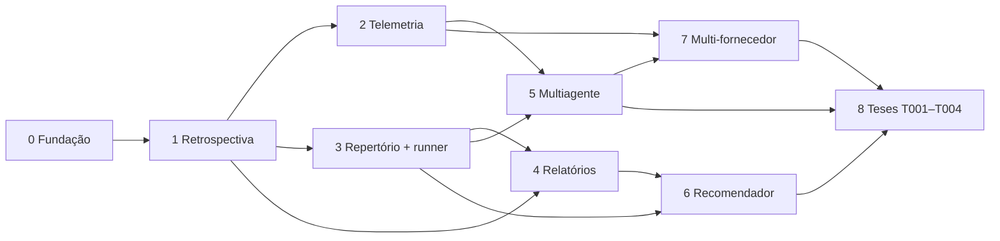

# Plano de implementação

> Roteiro para implementar o Vibe Code Metrics **usando o próprio método** (tese T000).
> Cada fase é entregue em PRs pequenos. A partir da Fase 1, cada PR termina com a retrospectiva
> de iteração. Arquitetura de referência: [arquitetura.md](arquitetura.md).

Legenda: `[x]` feito · `[ ]` a fazer · **Aceite** = critério objetivo para fechar a fase.

## Visão geral das fases

| Fase | Entrega | Depende de | Status |
|---|---|---|---|
| 0 | Fundação: pacote, documentação viva, balanço, CI, T000 | — | concluída |
| 1 | Retrospectiva automática por iteração, radar de semáforo, `vcm iniciar` | 0 | concluída (3 itens menores em aberto) |
| 2 | Telemetria de agentes e custo por iteração | 1 | concluída pelos logs de sessão (OpenTelemetry adiado) |
| 3 | Repertório, schema de tese e runner; primeira tese técnica (T005) | 1 | a fazer |
| 4 | Relatórios HTML com Plotly e painel histórico | 1, 3 | a fazer |
| 5 | Orquestração multiagente com avaliador trancado | 2, 3 | a fazer |
| 6 | Recomendador (`vcm sugerir`) | 3, 4 | a fazer |
| 7 | Multi-fornecedor (Codex, modelos locais) e política de dados | 2, 5 | a fazer |
| 8 | Teses do primeiro programa (T001–T004) no projeto-em-camadas | 3–7 | a fazer |

## Fase 0 — Fundação

- [x] `pyproject.toml` com `uv`, pacote `vcm` em `src/`, CLI `vcm`
- [x] `vcm.balanco`: tabela antes × depois, veredito com ruído, regra de decisão, convergência, com testes
- [x] `vcm docs`: Markdown → HTML único e determinístico, com diagramas Mermaid e `--check`
- [x] `docs/arquitetura.md` e `docs/plano.md` (este arquivo)
- [x] CI no GitHub Actions: `ruff`, `pytest` e `vcm docs --check`
- [x] `CLAUDE.md` com as regras para agentes
- [x] Esqueleto da tese T000 (`hypothesis.md`, `protocol.yaml`)
- [x] `docs/estilo.md`: regras de código do mantenedor (português, Python calcula, HTML apresenta, SI)

**Aceite:** `uv run pytest` verde; `uv run vcm docs --check` verde; HTML abre com navegação e diagramas.

## Fase 1 — Retrospectiva automática

Objetivo: toda iteração (commit ou PR) gera o balanço antes × depois sem trabalho manual.
Executada com agentes: **Opus** gerencia e integra; **Sonnet** e **Haiku** executam (modelo indicado em cada item).

- [x] `vcm.coletores.codigo` (Sonnet): SLOC e complexidade média (radon), nº de dependências (`pyproject.toml`), alertas de segurança (bandit)
- [x] `vcm.coletores.testes` (Sonnet): testes totais e falhando, cobertura (coverage.py), tempo da suíte
- [x] `vcm.coletores.determinismo` + `vcm.referencia` (Sonnet): N execuções do conjunto de referência em subprocesso, com fração de saídas idênticas por hash
- [x] `vcm snapshot [--ref REF]` (Opus): mede um ref via `git worktree` e grava uma linha em `results/snapshots.parquet`
- [x] `vcm balanco BASE HEAD` (Opus): compara dois snapshots, grava `results/iteracoes/` e gera o cartão em Markdown e HTML
- [x] Registro de execuções de agentes em `results/agentes/execucoes.csv` (Opus)
- [x] Estimar o **ruído** de cada métrica com repetições e gravar em `results/ruido.parquet`
- [x] GitHub Action em PR: roda o balanço contra a base e anexa o cartão HTML como artefato (escrita; o Actions da conta ainda não executa jobs)
- [x] Métricas de "enxuto" normalizadas: SLOC bruto passa a ser informativo; julgam-se SLOC por função, complexidade e dependências
- [ ] Tipo da iteração (funcionalidade, refatoração, correção) registrado no cartão
- [ ] Métrica separada de sensibilidade a threads (mesmo código com 1 thread × N threads)
- [x] Registrar a Fase 0 como linha de base da T000

Trabalho antecipado das Fases 3 e 4, a pedido do mantenedor:

- [x] Repertório inicial em `repertorio/` (Haiku): uma entrada YAML por alternativa, por papel
- [x] Protótipo da **T005 — perda de carga na adutora** (Sonnet): NumPy × Polars × Polars + NumPy, com dados sintéticos, gabarito analítico, runner e relatório HTML com Plotly

**Aceite:** o PR mostra o cartão com as 6 perguntas respondidas por números; uma regressão
proposital em teste resulta em `REVERTER`. **Atingido** no teste ponta a ponta (ver Fase 1b).

### Fase 1b — Pronto para usar num protótipo

- [x] `vcm.yaml` por projeto (`vcm.config`), com autodetecção de pastas quando não existe (Sonnet)
- [x] Coletores genéricos: determinismo, tempo e memória pelo comando de referência do projeto (Sonnet)
- [x] Radar de semáforo no cartão (`vcm.semaforo`, `limites_padrao.yaml`) (Sonnet)
- [x] `vcm iniciar`: adota o método num projeto em um passo (Sonnet)
- [x] README em Markdown correto (Haiku)
- [x] Ruído medido por repetição (`vcm.ruido`) e usado no balanço (Opus)
- [x] Tempo e memória viram informativos quando o conjunto de referência muda (Opus)
- [x] Guia rápido (`docs/guia.md`) e cartões de exemplo em `docs/exemplos/` (Opus)
- [x] Teste ponta a ponta num protótipo novo: iteração boa → `MANTER`; iteração sem semente → `REVERTER` com código de saída 2 (Opus)

### Fase 1c — Primeiro projeto real (projetos_em_camadas)

- [x] Diagnóstico de linha de base, só leitura (`results/diagnosticos/projetos_em_camadas_2026-10-31.html`)
- [x] Projeto sem `pyproject.toml`: `requirements.txt` + `dependencias_extras` no `vcm.yaml` (Sonnet)
- [x] `vcm iniciar` com pacote na raiz e integração com `pdca/` existente (Sonnet)
- [x] `vcm html`: relatórios Markdown → HTML (Opus)
- [x] `vcm agentes --pdca` lendo `pdca/agentes.jsonl` do projeto; aprovação desconhecida é NaN, não 0 (Haiku)
- [x] Adoção no `projetos_em_camadas`, passos 1–3 do diagnóstico (PR #25 lá, aguardando aprovação; balanço total MANTER)
- [x] Passo 4: testes de caracterização do pipeline `obra.py` (PR #37 lá): cobertura 38% → 90%, 8 comportamentos suspeitos registrados sem correção (Sonnet)
- [ ] Conferência JS × Python da medição interativa do visualizador

### Lições da Fase 1 (registradas pelo próprio método)

- **O balanço pegou um problema real.** O primeiro cartão (`18b6b59 → 8fe6d37`) propôs
  `REVERTER` por um alerta de segurança novo (B314, leitura de XML sem `defusedxml`). O alerta foi
  corrigido, não silenciado, e a troca (+1 dependência) aparece no cartão seguinte.
- **"Enxuto" precisa de contexto.** Numa iteração que adiciona funcionalidade, SLOC e
  dependências sobem por definição. Sem normalização, a regra sempre pede decisão humana. Isso
  virou item do plano.
- **Determinismo depende de threads.** Produto matricial e `solve` do NumPy mudam de hash entre
  1 thread e 4 threads, e são estáveis com o número de threads fixo. Isso foi registrado no
  repertório do NumPy, e a métrica separada virou item do plano.
- **O gerente também erra.** Um commit do Opus entrou com teste falhando, porque o código de
  saída do pytest foi mascarado num pipeline de shell. O balanço seguinte propôs `REVERTER` e o
  erro foi corrigido no commit seguinte. Regra: `set -o pipefail` em todo pipeline de verificação.
- **Agentes em paralelo duplicam utilidades.** O executor da T005 não via o `vcm.formatacao`,
  criado ao mesmo tempo pelo gerente, e escreveu o seu próprio. O gerente unificou na integração.
  A especificação deve listar os módulos compartilhados em construção.
- **Interfaces entre executores paralelos divergem em semântica, não em assinatura.** O
  executor da configuração tratou `limites` como sobreposição; o do semáforo, como lista
  completa. Com `limites: {}` o semáforo ficou todo cinza. Os testes de cada um passavam, e só o
  teste ponta a ponta revelou o problema. Regra: a especificação deve dizer o **significado** de
  cada campo compartilhado, e toda integração termina com um teste ponta a ponta.
- **O executor também corrige o gerente.** A especificação do radar tinha um erro de sinal no
  expoente. O executor detectou, explicou e implementou o sinal correto.
- **Eficiência só se compara com o mesmo trabalho.** Ao acrescentar um cálculo ao conjunto de
  referência, o tempo sobe por mais trabalho, não por código pior. Agora o hash da referência
  identifica o trabalho; se ele muda, tempo e memória viram informativos.
- **Ruído medido neste repositório** (3 repetições): tempo de referência ±6% (faixa aceita 12%),
  pico de memória ±0,1%, tempo da suíte ±1,3%.
- **Tempo curto exige tolerância absoluta.** No teste da `main` recém-publicada, uma iteração
  que só acrescentou um comentário deu `DECISAO_HUMANA`: o cálculo de referência de ~10 ms
  oscilou +23%. Correção com lógica de engenharia: piso absoluto de ruído (5 ms; 2 MB) e ruído
  automático = 2 × oscilação observada nas repetições do próprio snapshot. A mesma mudança agora
  dá `SEM_GANHO`, e a iteração sem semente continua `REVERTER`.
- **Portabilidade revisada antes da operação.** O `referencia.py` gerado usava o módulo
  `resource`, que não existe no Windows, e no macOS a unidade de memória é outra. Agora a medição
  é portável (`vcm.medicao`), e a memória fica "sem medição" quando não há como medir, sem quebrar.
- **Projeto real ≠ projeto de exemplo.** O primeiro projeto real não tinha `pyproject.toml`, tinha o
  pacote na raiz, dependências opcionais usadas pelos testes e um PDCA próprio com outra definição de
  "determinismo". Nenhum desses casos aparecia nos testes ponta a ponta com projetos criados do zero.
  Regra: diagnóstico só leitura antes de toda adoção.
- **Executores em paralelo precisam de cópias isoladas também no projeto de destino.** Dois
  executores na mesma pasta do `projetos_em_camadas` compartilharam o ambiente `uv`: um rodava
  `uv sync` enquanto o outro rodava testes, e apareceram falhas fantasmas. Sozinho, o resultado foi
  estável. Regra: paralelo só com worktree; na mesma pasta, em sequência.
- **A régua do projeto de destino também pega o gerente.** O `determinismo.py` do projeto em camadas
  reprovou uma lição registrada pelo Opus com formato errado. Respeitar e rodar as réguas
  existentes é parte da adoção.
- **Os logs de sessão mentem duas vezes se não forem lidos com cuidado.** A mesma resposta aparece
  em várias linhas (até 7×), e a retomada da sessão noutro diretório copia o histórico para outra
  pasta de projeto. Somando tudo, o custo saiu US$ 64,55; filtrando por pasta, US$ 29,87;
  deduplicando globalmente pelo `message.id`, US$ 43,01, contra US$ 42,39 da plataforma. Regra:
  conferir toda telemetria contra uma fonte independente antes de confiar nela.
- **O gerente é o maior custo.** Na rodada da Fase 2, Opus US$ 5,01 × Sonnet US$ 0,33 × Haiku US$ 0,02.
  O contexto longo da sessão principal (leitura de cache) domina. Isso é dado para a T003.
- **Medir o próprio método exige as mesmas cautelas de uma tese.** No primeiro relatório de efeito,
  o commit inicial vazio fazia a complexidade "piorar" 18% depois da adoção; sem ele, caiu 5%. Com 3
  commits depois da adoção, nenhum veredito se sustenta: o mínimo passou a 5 de cada lado.
- **O rumo precisa do relógio, não da memória do agente.** Na primeira rodada, o gerente escreveu
  à mão um fim de etapa no futuro (14:12, às 13:53). Datas de etapa só por `vcm rumo --etapa …
  --status …`, que grava o instante real.
- **Contar tokens exige dizer quais.** A leitura de cache multiplicava os tokens de uma etapa por
  100; o rumo conta os trabalhados (entrada, saída, escrita de cache) e deixa o resto para o custo.
- **Worktrees de agentes nasceram da `main`.** (Resolvido: com o trabalho na `main`, as worktrees
  já nascem com o projeto.) Os executores precisaram trazer a branch de
  trabalho. Até a branch ir para a `main`, a especificação de cada tarefa precisa dizer a base.

## Fase 2 — Telemetria de agentes

Objetivo: custo, tokens e tempo de cada iteração, ligados à tese e à tarefa.

- [ ] Documentar a ativação do OpenTelemetry (`CLAUDE_CODE_ENABLE_TELEMETRY=1`, OTLP, `OTEL_RESOURCE_ATTRIBUTES=tese=...,tarefa=...`) — adiado: os logs de sessão já dão tokens e custo sem coletor
- [ ] Receptor OTLP local — adiado pelo mesmo motivo
- [x] Parser dos logs de sessão locais (`vcm sessoes`): chamadas únicas, por agente (tipo e descrição do `meta.json`), por modelo, em Parquet (Sonnet)
- [x] `repertorio/modelos.yaml` com preços oficiais (entrada, saída, leitura e escrita de cache 5m/1h, prompt longo do Haiku), fonte e data (Opus)
- [x] Gasto dos agentes no cartão: chamadas, tokens e custo por modelo entre os dois commits (Opus)
- [ ] Edições rejeitadas e intervenções humanas (exigem os eventos `tool_decision`; ver OpenTelemetry)
- [ ] Indicadores: `tokens_por_aprovacao`, `custo_por_aprovacao` (incluindo tempo humano), `taxa_de_retrabalho`

**Aceite:** uma sessão real de Claude Code numa tarefa da T000 aparece no balanço com custo e
tokens; a soma confere com o painel do fornecedor dentro de 5%. **Atingido:** custo desta sessão
pelos logs US$ 43,01 × plataforma US$ 42,39 (diferença de 1,5%, explicada pelas chamadas feitas
depois da leitura da plataforma).

## Fase 3 — Repertório, tese e runner

- [ ] Schemas pydantic: entrada de repertório, `protocol.yaml`, registro de run (campos da seção 10 do README, mais git commit, lockfile, seed, versões do gabarito e do protocolo)
- [ ] `vcm tese nova Txxx` cria a estrutura da tese a partir de um modelo
- [ ] Runner: mesma entrada para cada alternativa, N repetições, subprocesso isolado, pico de RSS, hash dos dados de saída, tempo p50/p95
- [ ] Avaliador trancado: hash do avaliador e do gabarito gravado no protocolo e conferido no run
- [ ] Separação desenvolvimento/teste no gabarito (holdout congelado)
- [ ] **T005 — Perda de carga na adutora**: NumPy × Polars × Polars + NumPy
  - caso: perfil de 5 km com N trechos; Hazen-Williams e Darcy-Weisbach
  - gabarito: solução analítica ou de referência com tolerância **absoluta** (m.c.a.)
  - métricas: tempo, RAM, determinismo (threads 1 × N), SLOC, legibilidade (revisão)

**Aceite:** `vcm tese rodar T005` produz runs em Parquet e um `decision.md` preenchido com as evidências.

## Fase 4 — Relatórios HTML

- [x] Template base compartilhado com `vcm docs` (mesma identidade visual)
- [ ] Relatório de tese: protocolo, tabela por alternativa, gráficos Plotly (distribuição de tempo, Pareto custo × qualidade), decisão
- [x] Relatório de iteração: cartão com **radar de semáforo** (índice por dimensão e cor por limite)
- [ ] Painel histórico: trajetória de cada métrica por iteração, marcando convergência e degradação
- [ ] Índice `results/reports/index.html` ligando tudo

**Aceite:** os três relatórios abrem offline (Plotly embutido ou em CDN com fallback) e são gerados de forma determinística.

## Fase 5 — Orquestração multiagente

- [ ] Definição de agentes por papel (gerente, executor, revisor) com modelo vindo de `modelos.yaml`
- [ ] Loop PDCA: o gerente decompõe; o executor trabalha numa worktree; o avaliador confere; o balanço decide
- [ ] Orçamento por ciclo (tokens, tempo, custo) e critério de parada (convergência ou orçamento)
- [ ] Bloqueio de escrita em avaliador e gabarito (permissões do agente + hash conferido)
- [ ] Portão humano para trocas e para entradas no repertório
- [ ] **T003 — Roteamento**: mesmo conjunto de tarefas com Haiku, Sonnet e Opus como executores; custo por tarefa aprovada

**Aceite:** um ciclo autônomo de pelo menos 3 iterações numa tarefa da T000, com balanço
registrado e pelo menos uma decisão humana pedida e registrada.

## Fase 6 — Recomendador

- [ ] Índice de evidências por papel e perfil de problema
- [ ] `vcm sugerir --papel calculo --perfil n=5000,dtype=float64` lista as alternativas com evidência, as lacunas e a sugestão de nova tese
- [ ] Integração com o balanço: quando convergir, sugerir alternativa do repertório

**Aceite:** a consulta para o perfil da T005 retorna a alternativa vencedora com link para o run.

## Fase 7 — Multi-fornecedor e política de dados

- [ ] Camada de acesso a modelos (LiteLLM ou adaptadores próprios em `adapters/llm/`)
- [ ] Codex e pelo menos um modelo local de pesos abertos como alternativas no repertório
- [ ] Política de dados por classe (público, interno, confidencial do cliente) aplicada pelo runner
- [ ] Regressão automática ao incluir um modelo novo no catálogo

**Aceite:** a mesma tarefa roda em três fornecedores, com custo e qualidade comparáveis no mesmo relatório.

## Repertório de skills (02/11/2026)

- [x] Catálogo de skills em `repertorio/skills/` (projeto, plataforma, plugins, externas) e página `skills.md` gerada (Haiku + Sonnet + Opus)
- [ ] Skills próprias do método, instaladas pelo `vcm iniciar`: `vcm-iteracao` (especificar → executor → balanço → decidir → registrar) e `vcm-diagnostico` (linha de base de um projeto existente)
- [ ] Tese: medir o efeito de uma skill (mesma tarefa com e sem a skill: custo, retrabalho, aprovação)

## Desempenho do método (02/11/2026)

- [x] `vcm historico` e `vcm efeito`: antes × depois da adoção no histórico do git, com relatório HTML (Sonnet)
- [x] Mínimo de 5 commits de cada lado e exclusão de commits sem código (Opus, após o primeiro teste real)
- [x] Primeira leitura no `projetos_em_camadas`: inconclusiva (3 commits depois da adoção), como esperado
- [ ] Repetir a leitura quando houver 5+ iterações depois da adoção, com `--com-testes`
- [ ] Juntar os relatórios de vários projetos numa comparação entre projetos

## Rumo do desenvolvimento (02/11/2026)

- [x] `vcm rumo`: `rumo.yaml` (objetivo, critério de pronto, etapas, histórico), progresso, real × estimado, desvios, Markdown para PR e HTML (Sonnet)
- [x] Tempo: início, fim, dias corridos, horas de relógio da IA, horas de agente e paralelismo (Opus, pedido do mantenedor no meio da rodada)
- [x] Skill `vcm-rumo`, instalada pelo `vcm iniciar`, e regra no `CLAUDE.md`
- [x] Primeira rodada real: o rumo acusou "fora do plano" (o pedido de tempo) e um falso "estouro" de 127× (leitura de cache e etapas simultâneas); ambos tratados
- [x] Calibrar as estimativas com a razão real/estimado (rodada autônoma de 02/11: Sonnet com testes 0,9× em tokens e cerca de 0,2× em tempo; referência gravada na skill `vcm-rumo`)
- [x] Refatorar `rumo.carregar` (D, 29 → A, 5) e `config.carregar_config` (D, 23 → A, 3) em tabela de regras; nenhuma função D. A média ficou em 4,10, acima da meta de 4,0: as funções C que restam estão listadas nas correções sugeridas do cartão
- [x] Etapas do mesmo modelo em paralelo separadas pela descrição do agente (`E2: …`); antes contavam as chamadas uma da outra (falso estouro de 2,0×)

## Correções sugeridas e formulário de interação (02/11/2026)

- [x] `vcm.sugestoes`: o cartão e o rumo trazem "Correções sugeridas" (o quê, por quê, agente), geradas das medições; o vcm **sugere e não aplica**, porque aplicar exige aprovação humana (Sonnet)
- [x] Formulário padrão de interação: skill `vcm-formulario`, `vcm rumo --formulario` e regra no `CLAUDE.md`, instalados em todo projeto pelo `vcm iniciar` (pedido do mantenedor no meio da rodada, registrado no `historico`)
- [ ] Levar a skill `vcm-formulario` ao `projetos_em_camadas` (precisa de aprovação: muda o `CLAUDE.md` do projeto)
- [ ] Baixar a complexidade média para ≤ 4,0 a partir das funções C listadas no cartão

## Fase 8 — Primeiro programa experimental

Teses T001 (extração de pranchas), T002 (armazenamento espacial), T003 (roteamento) e T004
(determinismo) aplicadas ao **projeto-em-camadas**, que é consumido como repositório externo
com adaptadores próprios.

## Regras de execução deste plano

1. Um PR por item, ou por grupo pequeno de itens; nada de PR monolítico.
2. Todo PR atualiza os checkboxes deste arquivo e roda `uv run vcm docs`.
3. A partir da Fase 1, todo PR anexa o cartão de retrospectiva. `REVERTER` bloqueia o merge.
4. Decisões de arquitetura relevantes viram um registro curto em `docs/decisoes/` (formato ADR).
5. Itens que dependem de informação externa (preços, formatos de log, APIs) são verificados na documentação oficial **na hora de implementar**, com data e fonte.

## Decisões em aberto (para o humano)

- [ ] Qual projeto a referência "Document Parser Benchmark" do README queria citar? (Candidatos: OmniDocBench, olmOCR-Bench, docling-eval.)
- [ ] O uso será por assinatura ou por API? Isso define se o custo reportado é real ou equivalente.
- [ ] Quais classes de dados do projeto-em-camadas podem sair da máquina?
- [ ] Pesos de criticidade iniciais para o índice de determinismo.
